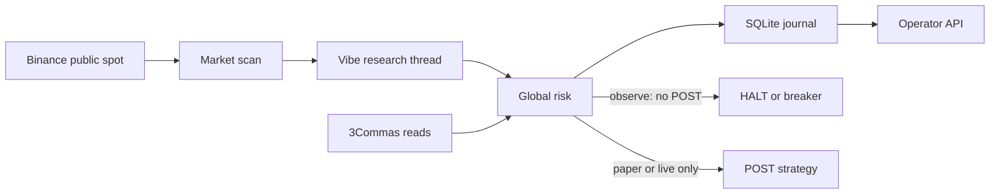

# WARP 3C Bot — System Architecture

## Responsibility boundary

- **Public market data**: Binance spot klines, 24h quote volume, and `exchangeInfo` filters from `WARP_MARKET_DATA_URL` (default `https://data-api.binance.vision`). This is the only numeric evidence that can make a signal executable. `api.binance.com` returned HTTP 451 from the build environment; the vision host served the same `/api/v3` routes.
- **Vibe-Trading**: proposes `BUY`, `WAIT`, or `SKIP`. It does not receive the 3Commas key, secret, profile code, live acknowledgement, or alert webhook. Shell tools are disabled. Model confidence is a filter, not a position size. Model prices and amounts are discarded.
- **WARP risk worker**: reads balances and strategies, applies deterministic limits, and is the only component that can call `POST /open_api/strategies/trade`.
- **3Commas**: places and manages the spot DCA strategy.
- **Fly.io**: one always-on Machine, one volume, region `sin`.

AI output cannot skip the risk engine. A failed or stale read fails closed and blocks new entries.

Auto discovery is off unless `WARP_DISCOVERY=auto`. The static `WARP_SYMBOLS` list stays the allowlist and the fallback when the public exchange read fails. A research thread cannot call the broker. Monitoring and reconciliation use their own intervals, so a slow research call does not delay the risk check.

Only the `trend_up` profile can size a new ladder. Range, downtrend, and high volatility do not open entries. Those bounds are code, not model output. Changing an existing 3Commas strategy is not implemented: the official edit, pause, and cancel contracts were not re-checked against a live response in this build. `HALT` and the risk breakers stop new entries and leave current positions untouched.

Alerts stay `pending` until the HTTPS webhook or Telegram call returns success. A failed send is retried with backoff. The operator page is `/dashboard`. JSON routes under `/api/` require `Authorization: Bearer` and the token is `WARP_OPERATOR_TOKEN`. The page can pause new entries. It cannot submit an order.

## Deployment / state

`/live` returns 200 when the process is up. `/ready` returns 200 only after a successful cycle whose dependencies answered. `/health` returns the same JSON and is not a trading approval. `execution_permitted` is false in observe mode.

`GET /open_api/api_profiles` and `GET /open_api/strategies/live` must return `items` plus `pagination.page`, `pagination.limit`, `pagination.total`, and `pagination.pages`. A bare list or a `data`/`has_more` body is incomplete and blocks entries. Every declared page is read, and a short page, repeated cursor, duplicate id, or total that does not match the items fails closed.

SQLite uses WAL and `synchronous=FULL`. The journal row is inserted before the POST. `unknown` stays blocking until `GET /open_api/strategies/{clientId}` or the live list returns that client id. A definite non-429 4xx marks the row `rejected` and does not retry that POST. HTTP 429 and 5xx on a POST stay `unknown`. GET requests may retry; POSTs never do.

The file lock plus `fly scale count 1` is the single-writer control. A second Machine would not share the volume lock and could double-submit, so the deploy procedure forbids it. `auto_start_machines` is false and `auto_stop_machines` is off.

Create `/data/HALT` to stop new submissions. It does not close 3Commas positions.

## Mode gates

1. `observe`: research and, when credentials exist, read-only account state. No strategy POST.
2. `paper`: the API profile `demo` flag must be true, and each managed strategy must report `paperTrading: true`.
3. `live`: `demo: false`, `paperTrading: false`, and `WARP_LIVE_EXECUTION_ACK=I_UNDERSTAND_LIVE_ORDERS`. That acknowledgement is not approval to turn live mode on.

## Sizing

- Reference capital is mark-to-market equity when the inputs are reliable. Live equity is the sum of spot asset balances times public USDT prices. Paper balances are not treated as a position ledger; open paper strategies are rebuilt from fill cost and public marks, and a broker `lastPrice` that disagrees with the public price by more than 2% makes the mark unreliable.
- Unreliable marks, stale account snapshots, missing strategy fields, unexplained live balances, and strategy quantities that exceed the wallet block new entries.
- Free USDT is reduced by the unfilled ladder on a live profile, and by the full ladder on a demo profile, before the reserve fraction is applied.
- The ladder uses `extraOrderCount` including the entry. `applyDcaForFirstSafetyOrder: false` repeats the base size on the first extra order. A fee buffer (`WARP_FEE_BPS`, default 10) is reserved on top.
- Caps: portfolio (`WARP_MAX_COMMITTED_FRACTION`), per pair, correlation group (default one book at `WARP_MAX_GROUP_FRACTION`), and free reserve. At most one new strategy per cycle. Active symbols and 24-hour confirmed or unknown client ids are skipped.
- Base size must clear the configured minimum and the Binance minimum notional. Quote size is rounded down to exchange quote precision.
- Daily loss and drawdown use prior reliable equity marks. The default fractions are engineering defaults, not a signed-off trading policy.
- Create payload uses `profiles: [{code, multiplier}]`. `profilesCodes` is not sent.

## Known gaps before any live use

1. No demo-account round-trip has been run. Strategy field names match the published schema, not a captured demo response.
2. GitHub Actions is blocked by an account billing lock, so CI has not executed these tests.
3. Correlation groups, volatility, RSI, daily loss, and drawdown defaults need Technical Lead confirmation.
4. Terminal strategies are invisible to the Open API. Use a dedicated profile.
5. Paper mark-to-market assumes free balance does not fall while a position is open. If a demo profile behaves differently, equity is conservative or marked unreliable.
6. Alert delivery now waits for an HTTP success before it is marked delivered. A Fly volume backup has not been restored; the SQLite backup helpers are covered by a local test only.
7. Editing, pausing, or cancelling an existing 3Commas strategy is not implemented.
8. Vibe signal quality is not forward-tested.

Do not enable real money until those gaps are closed and an operator explicitly turns live mode on.
